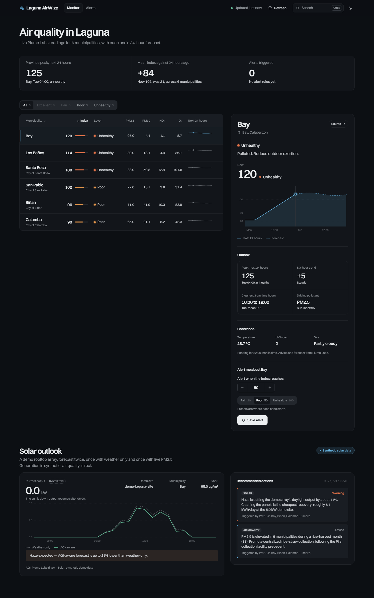
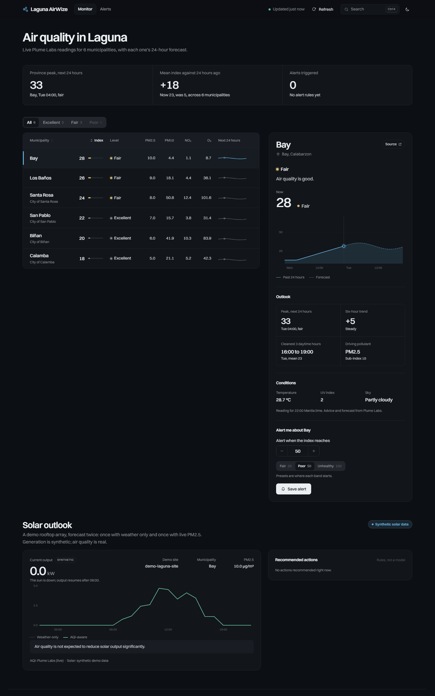

# Airwize demo script

Target length: 4–5 minutes, with a 30-second opening. The whole demo runs on
one page; no slides, no second app.

## 30-second problem statement

> Laguna burns rice straw and household waste, and the haze it produces does
> more than raise the air-quality index. It also settles on solar panels and
> cuts the power they make — exactly when the grid needs that power most. Today
> an LGU can see the AQI and can see a solar forecast, but not the link between
> them. Airwize puts both on one screen, using live Plume Labs PM2.5, a clearly
> labelled synthetic rooftop array, and two forecasts: one that ignores air
> quality and one that does not. The gap between the two lines is the decision
> support — clean the panels, pre-charge, or send a patrol.

## Before you present

1. Check the app is up (see `README.md`):
   - Go scraper: `cd webscraper && go run . -serve :8080 -interval 5m`
   - Flask: `python app.py`
2. Open <http://127.0.0.1:5000> and confirm the solar card shows a current value
   and two chart lines.
3. If the live scraper is flaky, rehearse with the offline fixture:
   ```bash
   python -m tests.fake_scraper --scenario hazy     # 6 municipalities in a haze event
   python -m tests.fake_scraper --scenario clear    # clean-air contrast
   ```
   Restart Flask only if you change `AIRWIZE_SCRAPER_URL`.
4. Keep the two screenshots at the bottom of this file open in a second window.

## Live walkthrough (4 minutes)

### 1. The AQI card (45 s)

- Start at the top. The province strip shows the next-24-hour peak, the mean
  change against yesterday, and any alerts. "Bay, 120, unhealthy" is the hook.
- Click **Bay**. In the detail panel point out:
  - the current level and Plume Labs' advice;
  - the 48-hour chart (past solid, forecast dashed), all in Manila time;
  - **Driving pollutant: PM2.5** — this is the pollutant the solar model uses.
- Say: "This is live Plume Labs data, scraped by the Go service every five
  minutes. Everything on this part of the screen is real."

### 2. The solar card (45 s)

- Scroll to **Solar outlook**.
- Point at the **Synthetic solar data** badge and the source line before anyone
  asks: "AQI: Plume Labs (live) · Solar: synthetic demo data".
- Read the current output and the site: a 5 kW demo array attached to the
  worst-reading municipality. At night it honestly reads 0.0 kW; after 06:00 it
  climbs toward the 5 kW nameplate (less when cloudy).
- Explain the model in one sentence: half-sine daylight, deterministic clouds,
  and PM2.5 attenuation `clamp(1 − 0.002 × PM2.5, 0.6, 1.0)`.

### 3. The divergence chart (60 s)

- The grey dashed line is the weather-only baseline. The green line is the
  AQI-aware forecast. Same array, same clouds — only the pollution input differs.
- On the hazy fixture the two lines separate through the middle of the day.
  Read the note under the chart: **"Haze expected — AQI-aware forecast is up to
  roughly 20% lower than weather-only."** The exact percentage is computed from
  the current forecast.
- Switch to the clear fixture (`--scenario clear`) and refresh: the lines sit on
  top of each other and the note flips to **"Air quality is not expected to
  reduce solar output significantly."** That contrast is the product.
- If asked why the forecast is linear regression on 48 hours of paired data:
  "It is deliberately small and inspectable. The deliverable is the pipeline
  and the decision, not a claim of photovoltaic accuracy."

### 4. Recommendations (60 s)

- Stay on the hazy fixture. The **Recommended actions** panel shows at most
  three rules, warnings first:
  - **Solar / Warning** — panel cleaning, with the estimated recovery in
    kWh/day. Evidence lists the municipalities driving the haze.
  - **Air quality / Advice** — during a harvest month, centralized rice-straw
    collection, citing the Pila facility precedent.
- Open the browser console? No. Instead say: "Every recommendation carries its
  evidence — the municipalities, the PM2.5 maximum, the mean forecast delta.
  These are rules, not a black box."

### 5. Close (30 s)

- One sentence: "The AQI is real, the solar generation is a labelled demo, and
  the forecasting and recommendation pipeline is the deliverable."
- Then the honesty line, verbatim (below).

## The honesty line — say it verbatim

> "AQI is real Plume Labs data; solar generation is synthetic for the demo; the
> forecasting and recommendation pipeline is the real deliverable."

Do not bury this. It buys more credibility than any accuracy claim.

## Backup screenshots

Use these if the network, the scraper, or the projector fails. Both were
captured from the offline fixture with animations disabled (reduced-motion) so
they show the settled state.

### Hazy day — divergence, cleaning warning, straw-collection advice



### Clear day — lines overlap, no action recommended



## If something breaks

| Symptom | Recovery |
|---|---|
| `Readings are unavailable` banner | The Go scraper is down. Start it, then press **Refresh**. If it stays down, switch to `python -m tests.fake_scraper` and keep presenting on the fixture (say so). |
| Solar card says "first pass may still be running" | The scraper has not completed its first pass. Wait ~30 s; the card retries by itself every 15 s. |
| Chart is flat or current output is 0 | It is night in Manila. Use the hazy screenshot above, or run the demo during daylight. |
| Lines do not diverge on a hazy day | Check that the municipality with the highest PM2.5 has PM2.5 in the snapshot and that the forecast series varies. The card marks `degraded` when PM2.5 is missing. |
| Projector shows the old page | Hard refresh (`Ctrl+Shift+R`). Static assets are served by Flask; no build step. |

## Anticipated questions

- **Is the solar data real?** No. It is generated from a documented formula and
  labelled synthetic in the badge, the card heading, the source line and the
  API payload (`"synthetic": true`).
- **Why a synthetic array instead of a real inverter?** One day, no hardware
  access, and the goal is the pipeline. A real inverter feed can replace
  `synthetic_generation` without changing the endpoint or the UI contract.
- **Why does the baseline predict lower than the actual synthetic output?** The
  baseline is a linear model fitted on a 48-hour window; it is a comparison
  signal, not a physics engine. The current kW reading is the direct synthetic
  value.
- **What would you validate next?** Held-out generation data from a real
  rooftop, a non-linear model, and a lag between PM2.5 and panel soiling rather
  than instantaneous attenuation.
- **Where do the recommendation thresholds come from?** `AIRWIZE_PM25_HIGH`
  (35 µg/m³) and `AIRWIZE_PM25_CRITICAL` (75 µg/m³) are configurable; the
  −5 % / −10 % solar thresholds live in `recommendations.py` next to the rules.
